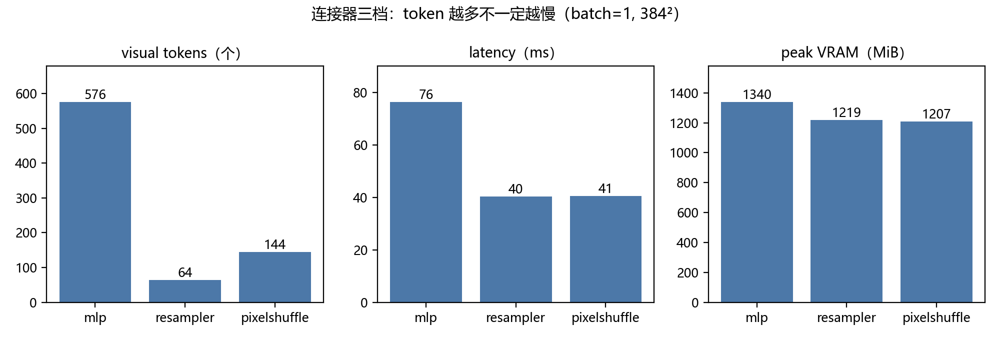
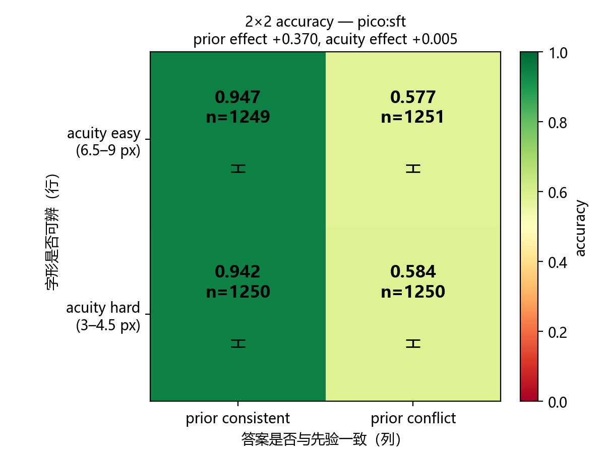

# PicoVLM 实验报告

> **这份文件是"人读版入口"；机器生成的完整报告在
> [reports/REPORT_2.0.md](reports/REPORT_2.0.md)，数字来源在
> [reports/RESULTS.json](reports/RESULTS.json)，声明对照在
> [stage9_report/CLAIMS.md](stage9_report/CLAIMS.md)。**
>
> 规矩：**先写结论，再写区间，最后写样本量**。没跑到的写 `TODO`，不写"预计"。

## 0. 摘要

用 8GB 笔记本显卡训了一个 5.89 亿参数的图表问答模型（可训练参数仅 3.38M），
然后用 **2×2 受控实验**（acuity 易/难 × prior 一致/冲突）拆开两种失败模式。
结论分成两层，**第二层推翻了第一层的一半**：

pilot 规模（train 156 条 / 237 步，dev_test 每格 20 族）：
- 一致格 0.950 / 1.000，冲突格 0.000 / 0.100；
- prior_effect **+0.950**，family 聚类 bootstrap 95% CI **[0.833, 1.000]**；
- 把图换成同数据集的另一张图，80 对里只有 1 对各不相同（McNemar **p = 1.0**）→ 看起来"没在看图"；
- 局部放大（salient）0.542 vs 全图 0.583，**−0.042**（不显著）→ acuity 不是瓶颈。

full 规模（train 19,998 条 / 2,500 步，约 4 小时）与 `locked_test` 一次性开封：
- 冲突格 **0.580 / 0.558**（dev_test）与 **0.577 / 0.584**（locked_test）——**不再是全灭**；
- prior_effect 降到 **+0.385**（dev_test）/ **+0.370**（locked_test，CI [+0.340, +0.400]）；
- 换图 **0.763 vs 0.342**，2,401 对 vs 300 对，McNemar **p < 1e-300** → 确实在看图；
- acuity_effect 仍 **+0.005**（CI [−0.013, +0.023]，跨 0）→ acuity 依然不是瓶颈。

一句话：**"小模型不看图"有一半是训练预算的锅，不是架构的宿命；而"分辨率不是瓶颈"这条在两种规模下都成立。**

## 1. 环境

见 [ENVIRONMENT.md](ENVIRONMENT.md)（自动生成）。
RTX 4060 Laptop 8188MiB（空闲 7099MiB，桌面程序可吃掉 7.8GB）、32GB RAM、
Python 3.11.11、torch 2.11.0+cu128、transformers 5.24.1、peft 0.22.0、Windows 11 原生。

实测基准（`stage0_env.benchmark`，2 次中位数）：

| suite | 延迟 ms | 峰值 alloc MiB | 峰值 reserved MiB |
|---|---:|---:|---:|
| load | 2947.8 | 1135 | 1192 |
| infer | 195.7 | 1416 | 1526 |

## 2. 数据

| 集合 | family 数 | 条数 | 说明 |
|---|---:|---:|---|
| train | 318 | 318 | 先验强度 ρ 请求 0.7 / 实测 **0.7406** 的偏斜训练集 |
| val | 78 | 78 | 平衡，调参 |
| dev_test | 80 | 80 | 4 格 × 20 族，每族一题 |
| locked_test | 160 | 160 | 4 格 × 40 族，只在最后一轮评测打开 |

`--profile full`（`data/full/`，同一套种子与阈值）：train **19,998** / val 2,496 /
dev_test 1,248（312/格）/ locked_test 5,000（约 1,250/格），28,742 张图，ρ 实测 0.7002。

- acuity 分箱（**预注册常量**）：easy ≥ 6.5px、mid ≥ 4.5px、hard ≥ 3.0px、< 3.0px 记 extreme（不进主比较）。
- 实测覆盖：hard 304 / easy 284 / mid 48 / extreme 0；字形像素 median 6.0px，范围 [3.0, 9.0]。
- 每条样本都能由 `meta.table` 复算答案（`validate.py` 会验）。

## 3. 训练

| 阶段 | 可训练参数 | 步数 | 时长 | 峰值显存 | 最终 loss |
|---|---|---:|---:|---:|---:|
| connector 对齐（pilot） | 2.30M | 60 | 45s | 3508 MiB | 0.61（val 0.483） |
| LoRA SFT（pilot） | 3.38M | 237 | ~4min | 3770 MiB | 0.45 |
| connector 对齐（full） | 2.30M | 1,250 | 2,657s | 5849 MiB | 0.575 |
| LoRA SFT（full） | 3.38M | 2,500 | 14,713s | 3770 MiB | 0.40–0.47 |

三个连接器的成本（`stage6_ablation.measure`，batch=1，384²）：

| 连接器 | 视觉 token | 参数 | 延迟 ms | 峰值显存 MiB |
|---|---:|---:|---:|---:|
| mlp | 576 | 2.30M | 76 | 1340 |
| pixelshuffle | 144 | 2.75M | 41 | 1207 |
| resampler | 64 | 20.04M | 40 | 1219 |

*图：token 数降 4× 只换来约 2× 的延迟下降——因为前向成本的大头在语言模型侧，
不在视觉 token 上。这条是选"mlp 576 token"的直接理由，也是 S6 的作业题底稿。*

## 4. RQ1：2×2 诊断（`correct_image`）

|  | 先验一致 | 先验冲突 |
|---|---:|---:|
| acuity 易 | **0.950** [0.764, 0.991] | **0.000** [0.000, 0.161] |
| acuity 难 | **1.000** [0.839, 1.000] | **0.100** [0.028, 0.301] |

*图：颜色是准确率，黑线是 Wilson 95% CI，每格 20 个家族。先验一致一侧全绿、
冲突一侧全红——**行方向（acuity）几乎没有变化**，列方向变化接近 1.0。*

- 先验效应（一致 − 冲突，易格）：**+0.950**，CI [0.833, 1.000]
- acuity 效应（易 − 难，一致格）：**−0.050**（CI [−0.167, 0.000]，方向与"难格更差"相反，即此规模下 acuity 不重要）
- VDR：easy 0.000 / hard 0.100
- 三条件对照（同 80 条，宽松判分）：correct_image **0.512** / mismatched_image **0.512** /
  prior_only **0.138**；correct 与 mismatched 逐样本配对：80 对里各只有 1 对翻转，
  **McNemar 精确检验 p = 1.0**（无显著差异）。

## 4b. full 规模重训与 locked_test 开封（主结论）

训练配置：`configs/align_full.yaml`（19,998 条，1 epoch，1,250 步，2,657s）→
`configs/sft_full.yaml`（2 epoch，bs=1×accum=16，2,500 步，14,713s wall，峰值 3,770 MiB）。

同一个 dev_test（每格 312 族）与 locked_test（每格约 1,250 族），三个条件：

| 格 | pilot 模型 | full 重训（dev_test） | locked_test（最终） |
|---|---:|---:|---:|
| 易·一致 | 0.950 | 0.965 | 0.947 [0.933, 0.958] |
| 易·冲突 | 0.000 | 0.580 | 0.577 [0.550, 0.604] |
| 难·一致 | 1.000 | 0.939 | 0.942 [0.928, 0.954] |
| 难·冲突 | 0.100 | 0.558 | 0.584 [0.556, 0.611] |

| 量 | pilot | full（dev） | locked |
|---|---:|---:|---:|
| prior_effect | +0.950 [0.833, 1.000] | +0.385 [0.325, 0.444] | +0.370 [0.340, 0.400] |
| acuity_effect | −0.050 [−0.167, 0.000] | +0.026 [−0.008, 0.060] | +0.005 [−0.013, 0.023] |
| 换图正确/错配 | 0.512 / 0.512 | 0.760 / 0.367 | 0.763 / 0.342 |
| 换图 McNemar p | 1.0 | 3.5e-90 | < 1e-300 |

读法：
- 冲突格从"全灭"变成"过半"——**先验效应大幅衰减**，说明模型在数据足够时确实会去读图；
- 换图的配对检验从 p=1.0 变成 p<1e-300——同一探针在两种预算下给出相反且干净的结论；
- acuity 的 CI 在三种设定下都跨 0——**"分辨率不是瓶颈"是最稳的一条**。

*图：最终模型在 locked_test 上的 2×2（每格约 1,250 族）。列方向掉 0.37，行方向几乎不动。*

## 5. RQ2：干预（pilot 规模，探索性）

| 臂 | 状态 | 观察 |
|---|---|---|
| + 分辨率课程 | 已实现（`--method curriculum`） | pilot 下未跑满，不足以给出配对结论 |
| + 反事实增广 | 已实现（20 → 60 条） | 增广后样本量与训练步数不匹配，留待 full |
| + 冲突加权 GRPO | 已跑探针（G=2–4，12 条） | **5/6 组优势恒为 0**，等于没梯度 |
| RFT 对照 | 已实现（拒绝采样） | 用于说明"同算力下 GRPO ≈ 加权 SFT" |

### E2 反事实测量（`stage5_intervene.invariance`，探索性）

| 改动 | n | 结果 |
|---|---:|---|
| 只改问句措辞（金标不变） | 6 | 不变性率 **1.000** [0.610, 1.000] |
| 改表里数值（金标换人） | 6 | 响应率 **0.000** [0.000, 0.390]，仍答旧答案 **0.833** |

读法：问法换了它照答不误，但**图里的数字变了它不知道**——直接证据，说明它读的是题面与先验。
n 很小（数值变体只支持 maxcat），只作旁证，不进主结论。

## 6. RQ3：迁移

ChartQA / TextVQA / OOD 风格：`TODO`（需要先有 full profile 与更长的训练；
当前模型在 pilot 上几乎完全依赖先验，迁移数字没有解释力，故意不填）。

## 7. 负结果（必须写）

1. **换图不掉点——只在 pilot 成立**：correct 0.512 vs mismatched 0.512（p = 1.0）；
   但 full 重训后同一探针给出 0.763 vs 0.342（p < 1e-300）。**这条负结果被自己的第二个实验推翻了**，
   是"训练预算不足"而非"架构不看图"的证据。
2. **放大不提升**：salient 0.542 vs full 0.583（−0.042，n=24，不显著）→ acuity 不是瓶颈
   （在 full 规模下 acuity_effect 的 CI 仍跨 0，这条没被推翻）。
3. **页内视觉召回失败**：recall@1 0.083 [0.023, 0.258]（冻结特征 + 平均池化，抹掉区分性信息）。
4. **GRPO 组内无信号**：5/6 组奖励全同；G 受 8GB 限制只能到 2–4。
5. **画风迁移归零**：同批题换画风 0.512 → 0.000，97.5% 输出空串（p = 9.1e-13），pilot 模型极脆。

## 8. 局限

- 合成数据的外部效度：结论只对"结构化图表 + 小答案空间 + 强先验"成立。
- full 重训是**单种子**（seed 17）；种子方差只在 pilot 上验过（17 vs 23：Δ +0.013，p = 1.0），
  full 规模下换种子的波动未知。
- RQ2 的三臂同算力对照**没有跑满**：只有 GRPO 的 G=2–4 探针，"课程 vs 反事实 vs GRPO"的配对表仍缺。
- ChartQA / TextVQA 等真实基准未接入（RQ3 只有 OOD 风格迁移这一条）。
- 判分：严格/宽松两套都记，但宽松口径下"金标作为独立 token 出现"可能高估。
